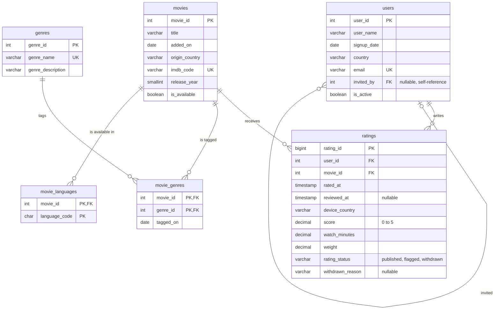

# Movie Ratings Platform: SQL Analytics Portfolio

**Author:** Auyon Haque · **Course:** EX 603 · **Theme:** 2 — Movie / TV

A PostgreSQL analysis of a movie-streaming platform's rating data that found
why a dashboard's failure rate was wrong, which titles drive the real problem,
and whether the platform is getting better, ending in four actions for the
next quarter.

> 🎥 **Video walkthrough (5 min):** [Watch on YouTube](VIDEO_URL_HERE)

---

## 1. The domain

The platform is a streaming service where **users** watch **movies** and leave
**ratings**: a score from 0 to 5, plus how many minutes they watched. Ratings
appear on each movie's page and feed its average score, so their quality
matters to viewers deciding what to watch, to recommendations, and to the
reviewers who are paid for qualifying ratings.

Not every rating survives. Moderators can **withdraw** a rating (for spam,
policy violations, duplicates, or at the user's own request) or **flag** it for
review. The project started when leadership stopped trusting a dashboard: it
claimed only 12 of 30 reviewers had any ratings that counted, and its failure
rate did not match anyone's experience.

Over six units the analysis worked through the questions the platform has to
answer:

- **Can the numbers be trusted?** What does the data contain, and why was the
  dashboard wrong? *(Unit 3)*
- **How big is the problem, and where is it?** The true failure rate by movie
  and region, against a fair baseline. *(Unit 4)*
- **Who is behind it, and who is missing?** Which movies fail often, which never
  get rated, and why those need different owners. *(Unit 5)*
- **Is it getting better or worse, and what should we do next quarter?**
  *(Unit 6)*

---

## 2. Database overview

All analysis runs on the reference dataset provided in Unit 3,
[`schema/movies.sql`](schema/movies.sql): 30 users, 15 movies, 5 genres and
200 ratings, all made in 2023. The file creates the tables, with every primary
key, foreign key and check constraint, and loads the data.



**The tables that matter for the analysis**

| Table | Role | Why it matters |
|---|---|---|
| `ratings` | The event (fact) table | Every question starts here. `rating_status` defines a failure (`withdrawn`), `rated_at` drives every trend, `score` is the metric, and `watch_minutes` turned out to explain the sharpest score drops. |
| `movies` | The producer | Reports start from `movies LEFT JOIN ratings`, so titles with no ratings show as 0 instead of disappearing. |
| `users` | The actor | Used to trace removals back to accounts, and in Unit 3 to fix who was owed a payout. |
| `genres`, `movie_genres` | Catalog and junction | Resolve the many-to-many between movies and genres. They revealed three movies with no genre at all. |

**Two facts about the data that every query has to respect**

- **Withdrawn ratings keep a placeholder score of 0.5.** It is not a real
  opinion. Counting it drags the platform's average from 3.33 down to 2.85, so
  every score average here leaves withdrawn ratings out.
- **`withdrawn_reason` is NULL for every rating that was not withdrawn.** A
  filter such as `withdrawn_reason <> 'Spam detected'` silently drops all 166 of
  them. That is the bug behind the original dashboard (Unit 3).

*Before the provided dataset, I designed my own schema for this theme in Unit 2
(films and series in one `titles` table, a genre hierarchy). That design and its
ERD are kept for reference in [`schema/schema.sql`](schema/schema.sql) and
[`schema/erd.png`](schema/erd.png). All queries use the Unit 3 tables above.*

---

## 3. Query catalogue

Every `.sql` file starts with a header naming the task it answers and the
question it resolves, and each query inside carries its own plain-language
question.

### Unit 3: Can the numbers be trusted?

| File | Query | Business question |
|---|---|---|
| [`q3_1.sql`](queries/unit3/q3_1.sql) | 3.1a | Which available movies were released after 2015? |
| | 3.1b | What statuses can a rating have, and how many of each? |
| | 3.1c | Which ratings score 4–5, and which are not normal published ratings? |
| | 3.1d | Which ratings have no withdrawal reason, and how should a blank read? |
| | 3.1e | Can a non-technical reader tell a real low score from a removed one? |
| [`q3_2.sql`](queries/unit3/q3_2.sql) | Part A | Why did the dashboard count only 22 qualifying ratings and 12 reviewers? |
| | Part B | Why can't a `SELECT` alias be used in `WHERE`, and how do we rewrite it? |
| [`q3_3.sql`](queries/unit3/q3_3.sql) | Forms 1–3 | Which reviewers have never had a rating withdrawn as spam? (`NOT IN`, CTE, `EXCEPT`) |
| | C1–C2 | Do the three forms really agree, and when does `NOT IN` return nothing? |

### Unit 4: How big is the problem, and where?

| File | Query | Business question |
|---|---|---|
| [`q4_1.sql`](queries/unit4/q4_1.sql) | Q1 | What does the whole platform look like: count, total, average, range? |
| | Q2 | Which movies are rated most, and how well? |
| | Q3 | Which movies have enough ratings for their failure rate to mean anything? |
| | Q4 | How did each movie do in each region? |
| [`q4_2.sql`](queries/unit4/q4_2.sql) | Part A | For each movie, how many ratings were received and how many withdrawn, in one pass? |
| | Part B | What is each region's failure rate, and the platform total? (`ROLLUP`) |
| | Part C | What failure rate is normal for a movie, and which are well above it? |

### Unit 5: Who is behind it, and who is missing?

| File | Query | Business question |
|---|---|---|
| [`q5_1.sql`](queries/unit5/q5_1.sql) | Q1 | Who wrote each rating, for which movie, and when? |
| | Q2 | Which movies are tagged Comedy, and do genres explain the failures? |
| | Q3 | Do the flagged movies' look-alikes (same country or year) fail as often? |
| [`q5_2.sql`](queries/unit5/q5_2.sql) | Part A | Which movies does an inner join silently leave out? |
| | Part B | Are there movies without ratings *and* ratings without a movie? |
| | Part C | Which movies have never been rated? (`NOT EXISTS` vs `EXCEPT`) |
| [`q5_3.sql`](queries/unit5/q5_3.sql) | Part A | Which genre tags could each movie have, and which are missing? (`CROSS JOIN`) |
| | Part B | How does PostgreSQL execute the three-table join, and why that way? |

### Unit 6: Is it getting better, and what next?

| File | Query | Business question |
|---|---|---|
| [`q6_1.sql`](queries/unit6/q6_1.sql) | Q1 | Is a rating unusually high or low for its own movie? (`AVG OVER PARTITION BY`, vs. `GROUP BY`) |
| | Q1 supporting | Do the unusual ratings come from people who watched? How much do they move each average? |
| | Q2 | Where would each movie sit on a "most rated" leaderboard, and how are ties treated? (`ROW_NUMBER`, `RANK`, `DENSE_RANK`) |
| | Q3 | Which quarter of the catalog is each movie in, and are any ties split? (`NTILE`) |
| [`q6_2.sql`](queries/unit6/q6_2.sql) | Part A | Is movie 11's score rising or falling, rating by rating? (`LAG`, `LEAD`) |
| | Part B | How many ratings have been lost so far, what is the recent failure rate, and did Q4 hit its target? (running total, moving average) |
| | Part C | When did a movie stop receiving ratings, and was the data lost? (gap detection) |
| [`q6_3.sql`](queries/unit6/q6_3.sql) | Part A | Which three reviews should each movie page feature? (top-N per group, `FIRST_VALUE`, `LAST_VALUE`) |
| | Part B | Is the platform better or worse each month and each quarter? (`LAG`, `NULLIF`, missing-month check) |

Written analysis for each unit is in [`/analysis`](analysis), and each unit's
memo to leadership is in `analysis/unitN-finding.md`.

---

## 4. Technical highlights

**1. Three-valued logic: finding 166 rows that vanished without an error**
*(Unit 3, [`q3_2.sql`](queries/unit3/q3_2.sql))*
The dashboard filtered `WHERE withdrawn_reason <> 'Spam detected'`. For a NULL
reason, that comparison is UNKNOWN, not TRUE, so every ordinary rating was
dropped with no warning. I proved it by showing the two "opposite" filters
summed to 34, not 200, then fixed it with an explicit `OR withdrawn_reason IS
NULL`. The same logic explains why `NOT IN` returns nothing when its list
contains a NULL (`q3_3.sql`, C2). **Why it mattered:** it was the difference
between paying 12 reviewers and paying all 30.

**2. Conditional aggregation and `ROLLUP`: one pass, every level**
*(Unit 4, [`q4_2.sql`](queries/unit4/q4_2.sql))*
`SUM(CASE WHEN rating_status = 'withdrawn' THEN 1 ELSE 0 END)` counts totals and
failures in a single scan, and `GROUP BY ROLLUP (device_country, movie_id)`
with `HAVING GROUPING(movie_id) = 1` returns regional subtotals and the platform
total together. A two-step CTE then built a fair baseline (16.5%) from only the
movies with enough ratings to judge. **Why it mattered:** the regional totals
add up exactly to the platform's figure, so nothing is double-counted or
missing.

**3. Outer joins and anti-joins: seeing what isn't there**
*(Unit 5, [`q5_2.sql`](queries/unit5/q5_2.sql))*
An inner join from `movies` to `ratings` returns 13 movies; a left join returns
15. I counted `DISTINCT movie_id` rather than rows (202 vs 200 hides that two
whole movies are missing), and confirmed the answer two ways, `NOT EXISTS` and
`EXCEPT`. **Why it mattered:** movies 14 and 15 had never been rated, and no
report built on an inner join would ever have shown it.

**4. Reading execution plans instead of assuming them**
*(Unit 5, [`q5_3.sql`](queries/unit5/q5_3.sql); Unit 6, [`q6_1.sql`](queries/unit6/q6_1.sql))*
The three-table join used a Hash Join for users and a Nested Loop with Memoize
for movies (187 of 200 lookups were cache hits), because two tables had never
been analyzed and the planner guessed 100 users instead of 30. After `ANALYZE`
the same query switched to two Hash Joins. The Unit 6 window query shows a
Seq Scan → Sort on the `PARTITION BY` key → WindowAgg, returning all 200 rows.
**Why it mattered:** the algorithm depends on what the planner knows, and the
plan shows which index or statistics a slow report actually needs.

**5. Window functions: context without losing detail**
*(Unit 6, [`q6_1.sql`](queries/unit6/q6_1.sql), [`q6_2.sql`](queries/unit6/q6_2.sql), [`q6_3.sql`](queries/unit6/q6_3.sql))*
`AVG(score) FILTER (WHERE rating_status <> 'withdrawn') OVER (PARTITION BY
movie_id)` puts each movie's true average on every rating, which is how the
short-watch pattern was found. `LAG(rated_at)` in a CTE, filtered outside it,
found movie 11's 136-day gap. The top-3 query breaks ties with a stated rule
(score, then watch time, then date) instead of leaving them to `ROW_NUMBER`'s
arbitrary order. The monthly trend runs `LAG` over a `generate_series` calendar,
so a missing month can't make it compare the wrong months. **Why it mattered:**
each of these questions compares a row with its group or its neighbours, which
`GROUP BY` alone cannot do.

---

## 5. Findings and recommendations

**1. The dashboard was wrong, and the true failure rate is 17%.**
Its filter silently excluded every rating with a blank withdrawal reason (Unit
3), and the 0.5 placeholder on withdrawn ratings was being counted as a real
score (Unit 4). Corrected: 34 of 200 ratings withdrawn, and an average score of
3.33, not 2.85.
→ *Every rule on `withdrawn_reason` must state what a blank means, and every
score average must exclude withdrawn ratings.*

**2. The rate improved once and then stalled, and one movie drives the worst
months.**
The failure rate fell from 22.6% in Q1 to about 15% and stayed there through Q4.
March (27.3%) and June (25.0%) were the worst months, and 4 of their 8
withdrawals were on movie 11, which also went 136 days without a rating that
stayed on its page (Units 4–6).
→ *Trust & Safety finishes a targeted review of movies 11, 9 and 2. Analytics
replaces the dashboard figure with a monthly report that uses quarterly and
rolling rates and agreed triggers for action.*

**3. A third of the ratings we keep come from people who barely watched.**
55 of the 166 kept ratings came from viewers who watched under 10 minutes. They
average 1.73 against 4.12 for everyone else, they pull the platform average
from 4.12 to 3.33, and they caused 12 of the 13 sharpest score drops. Their share
was the highest of the year in Q4 (43.9%).
→ *Product tests a minimum-watch rule for one quarter (labelling, holding out
or down-weighting short-watch ratings) without deleting any, then decides.*

Full reasoning, owners and targets: [`analysis/unit6-finding.md`](analysis/unit6-finding.md).

---

## 6. Limitations and future improvements

**The platform records viewing only when someone leaves a rating.** There is no
table of plays or sessions, so `watch_minutes` exists only on rating rows, and
nothing records how long each movie is. That one gap limits three conclusions:

- A movie with no ratings (14 and 15) cannot be told apart from one that is
  watched but never rated, or one that will not play.
- A quiet spell, like movie 11's 89 days with no ratings, could be a real lull
  or a period when the movie was hard to reach.
- A 4-minute rating could be careless, or honest feedback from someone who quit
  because they disliked the movie. "10 minutes" is a fixed cut-off, not a share
  of the runtime.

**What would address it:** a `viewing_sessions` table (user, movie, start and
end time, completed or not) and a `runtime_minutes` column on `movies`. With
them, short-watch ratings could be judged as a share of the movie, unrated
titles could be split into "unwatched" and "watched but unrated", and gaps
could be checked against actual viewing. A second year of data would also be
needed to tell whether the March and June spikes are seasonal.

---

## 7. Video presentation

🎥 **[Watch the 5-minute walkthrough](VIDEO_URL_HERE)**: the business question,
three queries shown running, the key findings, and one limitation.

---

## 8. How to run it

**You need:** PostgreSQL 14 or later, with `createdb` and `psql` on your path.
Nothing else.

```bash
# 1. Get the code
git clone https://github.com/YOUR_USERNAME/YOUR_REPO.git
cd YOUR_REPO

# 2. Create the database and load the schema and data
createdb ex603_data
psql -d ex603_data -f schema/movies.sql

# 3. Run any query file (-e prints each query above its result)
psql -d ex603_data -P pager=off -e -f queries/unit6/q6_1.sql
```

`movies.sql` drops its tables before creating them, so it can be re-run
safely. Every query file is read-only. One query fails on purpose:
`q3_2.sql` B1 reproduces the alias error from Unit 3, and `psql` reports it and
carries on with the rest of the file.

---

## Repository structure

```
.
├── README.md
├── schema/
│   ├── movies.sql          # Unit 3 provided DDL + data (used by all queries)
│   ├── schema.sql          # Unit 2: my own schema design
│   └── erd.png             # Unit 2: ERD of that design
├── queries/
│   ├── unit3/  q3_1.sql  q3_2.sql  q3_3.sql
│   ├── unit4/  q4_1.sql  q4_2.sql
│   ├── unit5/  q5_1.sql  q5_2.sql  q5_3.sql
│   └── unit6/  q6_1.sql  q6_2.sql  q6_3.sql
├── analysis/
│   ├── unit2.md … unit6.md           # write-ups per unit
│   └── unit3-finding.md … unit6-finding.md   # memos to leadership
└── screenshots/            # every query run with its output, named by task
```

**Execution evidence for Unit 6** (in [`/screenshots`](screenshots)):

| File | Shows |
|---|---|
| `6_1_partition_avg_ranking_ntile.png` | Full run of `q6_1.sql`, including the EXPLAIN plan and the **ranking tie**: movies 5 and 7 both rank 4 under `RANK`, 4 and 5 under `ROW_NUMBER` |
| `6_2_lag_lead_running_total_gaps.png` | Full run of `q6_2.sql` |
| `6_3_top3_per_movie_month_over_month.png` | Full run of `q6_3.sql`, including the **top 3 per movie** output (39 rows) |
